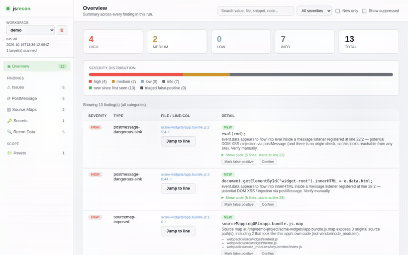
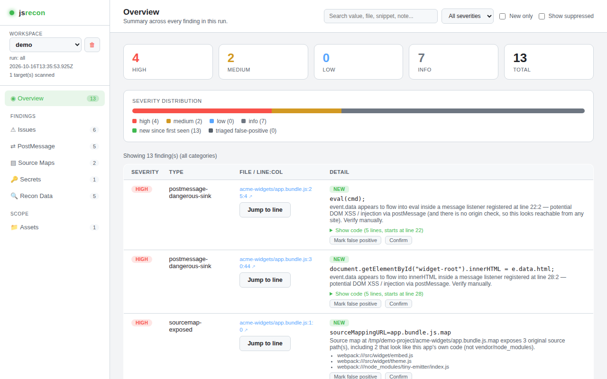
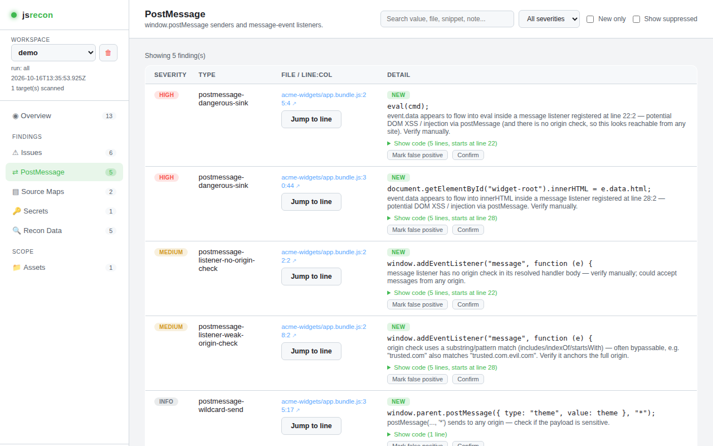
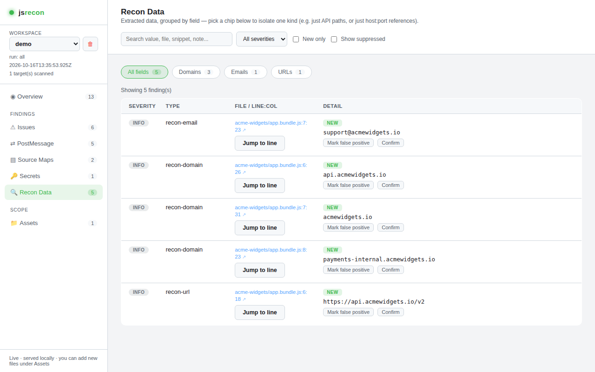
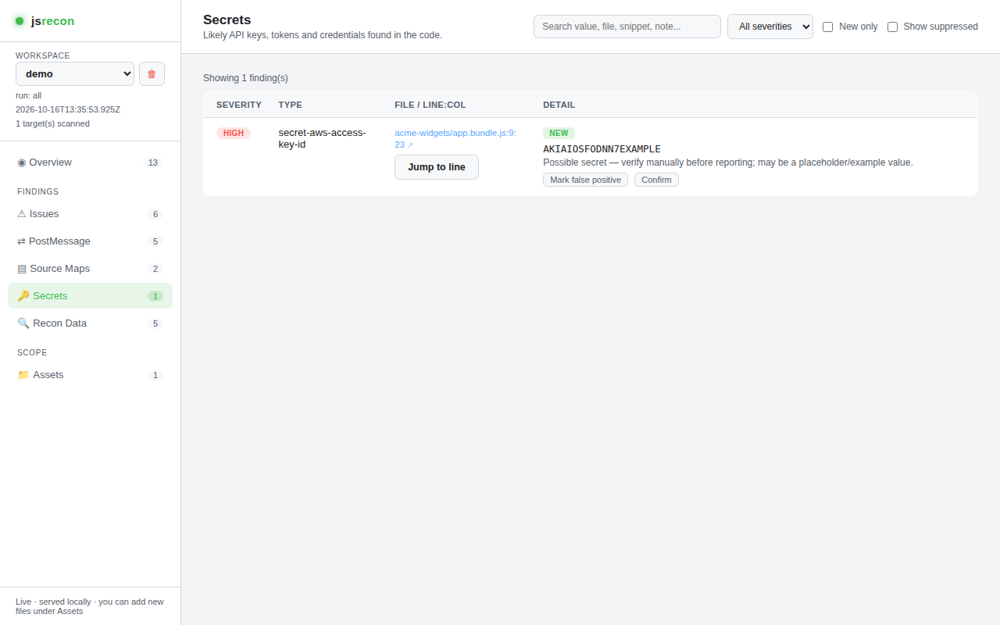

# Jsrecon

[](https://github.com/abidakun1/jsrecon/actions/workflows/test.yml)
[](LICENSE)
[](package.json)

A local, offline static-analysis CLI (+ self-contained HTML dashboard) for JS
recon during **authorized** security testing — bug bounty, pentest, or your
own app's CI.




Point it at a single file, a URL, a local directory, or crawl a domain. It
reports:

- **postMessage security issues** — listeners missing/weak origin checks,
  wildcard (`'*'`) sends, `eval`/`innerHTML`/other dangerous-sink taint flows,
  WebSocket/BroadcastChannel message handling, insecure `ws://` URLs,
  `importScripts`, `document.domain` relaxation, `window.open` missing
  `noopener`, and a cross-file pass that follows `event.data` through
  `require()`/`import` into another scanned file's exported function.
- **Exposed source maps** — resolves/fetches `sourceMappingURL` references
  and reports which original source paths they leak (and whether that's your
  own app code or just vendor/build-tool noise).
- **Recon data** — emails, domains, IPv4s, API/endpoint-looking paths,
  URLs + query params, S3 buckets, social links, npm packages, GraphQL
  operations, and more.
- **Likely secrets** — AWS/GCP/Slack/Stripe/GitHub/etc. key formats, JWTs,
  private key blocks, generic `key:`/`secret:`/`token:` assignments, and a
  Shannon-entropy fallback for anything that doesn't match a known prefix.

Nothing here brute-forces, exploits, or evades anything — it's pattern
matching over static text, meant to point you at things worth a manual look.

*(Demo scan is a synthetic `app.bundle.js` built specifically to trigger one
finding per category — not a real target.)*

## Why

Most JS-recon tooling either ships as a browser extension, phones data home,
or buries the interesting signal (a real dangerous-sink finding) under a pile
of regex false positives. jsrecon is a single local process: your targets
never leave your machine unless you explicitly fetch a URL, and a lot of this
project's effort has gone into cutting the false-positive rate on the
postMessage/recon/secrets detectors specifically (see
[`test/analyzers.test.js`](test/analyzers.test.js) — most of its cases are
regression tests for a real false-positive or false-negative that got fixed).

## Install

```bash
git clone https://github.com/abidakun1/jsrecon.git
cd jsrecon
npm install
npm link   # optional: puts `jsrecon` on your PATH
```

Requires Node.js 18+ (uses native `fetch` and the built-in `node:test`
runner).

## Quick start

```bash
# Scan a single bundle
jsrecon -u ./app.bundle.js

# Scan a live URL, saved into a named workspace
jsrecon -u https://example.com/main.js -wksp example

# Scan every JS file in a directory (also runs the cross-file taint pass)
jsrecon -d ./src -wksp myapp

# Crawl a domain for JS files instead of a local directory
jsrecon -d example.com -depth 3 -keywords api,admin -wksp example

# Build and serve the HTML dashboard for a workspace
jsrecon --ui --serve -wksp example
# -> http://127.0.0.1:5757
```

Every scan is saved to a local workspace (`~/.jsrecon/workspaces/<name>/` by
default) so you can re-query it later, diff what's new since your last scan,
triage findings as false-positive/confirmed (persists across future scans of
the same value), and correlate values across targets and workspaces.

Run `jsrecon --help` for the full flag reference — scan targets, triage,
allowlisting, reverse search, and the dashboard are all covered there in
detail.

## The dashboard

`jsrecon --ui --serve -wksp <name>` builds a self-contained HTML dashboard
(categorized by PostMessage / Source Maps / Recon Data / Secrets, with
severity, new-since-last-scan badges, cross-target/cross-workspace
correlation notes, and in-place triage buttons) and serves it locally. No
external requests, no analytics, nothing leaves your machine.

<table>
<tr>
<td></td>
<td></td>
</tr>
<tr>
<td></td>
<td></td>
</tr>
</table>

## Project layout

```
bin/jsrecon.js     CLI entry point — argument parsing, workspace/triage/
                   allowlist commands, remote fetch + retry/backoff, the
                   dashboard server.
lib/analyzers.js   Pure, side-effect-free detection functions (postMessage,
                   recon, secrets, cross-file taint). No network, no
                   filesystem, no CLI state — this is what test/ exercises
                   directly.
lib/workspace.js   Local workspace/run persistence, triage, allowlist,
                   cross-target/cross-workspace correlation.
lib/beautify.js    Dependency-free JS unminifier/tokenizer, also reused as
                   the comment/string-safe "mask" that keeps brace/paren
                   matching from breaking on unbalanced brackets inside
                   strings, comments, and regex literals.
lib/ui.js          Builds the self-contained HTML dashboard.
lib/crawl.js       Lightweight same-origin crawler for `-d <domain>`.
test/              Unit tests (node:test) against lib/analyzers.js.
```

## Contributing

See [CONTRIBUTING.md](CONTRIBUTING.md). `npm test` runs the full suite — PRs
that touch `lib/analyzers.js` should come with a test case showing the
specific false positive/negative being fixed or the new detection working
(that's the pattern the existing suite follows throughout).

## Security

Found a vulnerability in jsrecon itself (not a finding it produced about
*your* target)? See [SECURITY.md](SECURITY.md) for how to report it.

## Legal / ethical use

**This tool is for use only on systems and code you own, or are explicitly
authorized to test** (an in-scope bug bounty/pentest engagement, your own
application, etc.). It does not exploit anything, brute force credentials,
evade WAFs/IP blocks, or exfiltrate data anywhere — it reads files/URLs you
point it at and reports pattern matches for manual review. You are
responsible for how you use it and for complying with the terms of whatever
program or engagement you're working under. The author and contributors
accept no liability for misuse.

## License

[MIT](LICENSE)
